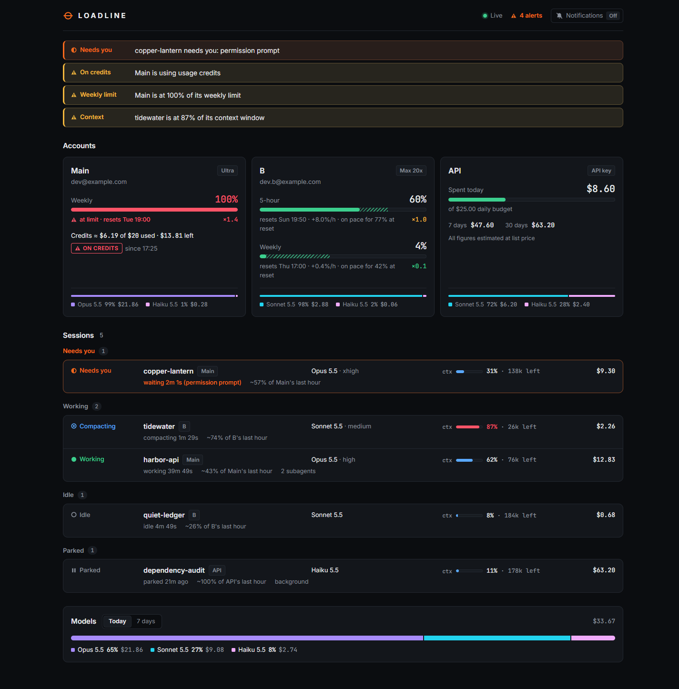

# Loadline

Loadline shows every Claude Code session running on your computer in one live browser window: which
account each one uses, what it is doing, whether it is waiting on you, how full its context is, which
models it is spending on, and how close each account is to its usage limits. Without it, you check
`/usage` and the status line one terminal at a time. Loadline is a single static binary that runs
only on your machine, reads only the interfaces Claude Code documents, and never sees your prompts,
responses or code.



## Install

Loadline needs Claude Code 2.1.300 or later, on Windows, macOS or Linux.

1. Download the archive for your system from the
   [releases page](https://github.com/dsj7419/loadline/releases) and extract it. Each archive and
   `checksums.txt` carries a build provenance attestation, which you can check with the GitHub CLI:

   ```sh
   gh attestation verify loadline_<version>_<os>_<arch>.tar.gz --repo dsj7419/loadline
   ```

   On macOS, a binary downloaded through a browser is quarantined; once you have verified it,
   clear that with `xattr -d com.apple.quarantine ./loadline`.

2. Run the installer from the extracted folder (`.\loadline.exe install` on Windows):

   ```sh
   ./loadline install
   ```

   It lists every change, shows the diff of your settings file with the ingest token masked, and
   asks before writing anything. `--dry-run` shows the changes and writes nothing; `--yes` applies
   them without asking. The installer copies the binary into the Loadline data directory, so you
   can delete the downloaded copy afterwards.

3. Start a new Claude Code session. Its first hook starts the Loadline server, which opens the
   dashboard. Sessions that were already running show up fully once you restart them.

To see the dashboard before installing, run `./loadline serve --demo`: it serves a made-up machine
and leaves your Claude Code settings alone.

With Go 1.26 or later you can also build it yourself:
`go install github.com/dsj7419/loadline/cmd/loadline@latest`.

### Commands

| Command | What it does |
| --- | --- |
| `loadline install [--config-dir DIR]... [--port N] [--dry-run] [--yes]` | Wires Loadline into the `settings.json` of each Claude Code config directory (default `~/.claude`). Repeat `--config-dir` for several. `--port` points the telemetry settings at another port than the configured one. |
| `loadline uninstall [--config-dir DIR]... [--dry-run] [--yes]` | Takes Loadline's entries out again and restores your status line. |
| `loadline doctor [--config-dir DIR]...` | Checks the setup, the server and the feeds that reach it. Changes nothing. |
| `loadline open` | Opens the dashboard, starting the server first if none is running. |
| `loadline status` | Prints the accounts and the sessions that have not ended, as a table. |
| `loadline serve [--port N] [--no-open] [--demo]` | Runs the server in the foreground, logging to `loadline.log` in the data directory. The hooks start it in the background for you. `--no-open` keeps it from opening the dashboard; `--demo` serves made-up data and takes no events. |
| `loadline hook` | Run by Claude Code's hooks. Forwards the hook event on stdin and prints nothing. |
| `loadline tap [--print \| --run CMD \| --run-b64 CMD]` | Run by the status line. Passes the status-line input through and forwards it. `--print` prints a one-line status of its own; `--run` and `--run-b64` run your status-line command (the latter base64url-encoded) with the input on its stdin. |
| `loadline version` | Prints the version. |

Commands exit 0 on success, 1 on failure and 2 for a usage error; `hook` always exits 0. A command
that takes flags lists them with `-h`.

### Configuration

Loadline works without a config file. To change a default, create one with just the keys you want:

| System | Config file |
| --- | --- |
| Windows | `%APPDATA%\loadline\config.json` |
| macOS | `~/Library/Application Support/loadline/config.json` |
| Linux | `$XDG_CONFIG_HOME/loadline/config.json` (default `~/.config/loadline/config.json`) |

```json
{
  "browser": "brave",
  "accounts": [
    { "configDir": "~/.claude", "label": "Main" },
    { "configDir": "~/.claude-work", "label": "Work", "dailyBudgetUSD": 25 }
  ]
}
```

| Key | Default | Meaning |
| --- | --- | --- |
| `port` | `8289` | Loopback port of the dashboard and the ingest endpoint, 1024 to 65535. Run `loadline install` again after changing it, so the settings send telemetry to the new port. |
| `openOnStart` | `once_per_login` | When a starting server opens the dashboard: `once_per_login` (the first start after the computer boots), `always` or `never`. |
| `browser` | `auto` | `auto` for the system default, `brave`, `chrome`, `edge`, `firefox`, or the absolute path of a browser. |
| `appWindow` | `true` | Opens a Chromium-family browser as an app window, without tabs or an address bar. Firefox and the system default ignore it. |
| `idleExitMinutes` | `30` | How long the server keeps running with no live session. `0` keeps it running. |
| `retentionDays` | `30` | How many days of history the server keeps. |
| `claudePath` | `""` | The `claude` executable to run. Empty means the one on `PATH`. |
| `alerts.weeklyPct` | `90` | Alert when an account reaches this share of its weekly limit. |
| `alerts.contextPct` | `85` | Alert when a session's context window is this full. |
| `alerts.needsYouSeconds` | `20` | Alert when a session has waited on you this long. |
| `accounts` | `[]` | Claude Code config directories to watch from the start, each with `configDir` (absolute, or starting with `~/`), an optional `label`, an optional `dailyBudgetUSD` and optional `credits` (see [Usage credits](#usage-credits)). |

Unknown keys and out-of-range values are errors, which `loadline doctor` reports. The server reads
the file when it starts.

## What install changes, and how to undo it

`loadline install` changes three things:

- **The binary.** It copies itself to `bin/loadline` (`bin\loadline.exe` on Windows) in the data
  directory, and the settings run that copy, by its absolute path written with forward slashes.
- **The ingest token.** It creates `token` in the data directory: 32 random bytes, hex-encoded,
  readable only by you.
- **Each `settings.json`.** It edits only the values below and leaves formatting, line endings and
  every other key as they were. It refuses a file that is not valid JSON, saves a backup beside it
  as `settings.json.loadline-<YYYYMMDD-HHMMSS>.bak`, and replaces the file atomically. It writes
  nothing if the file changed after it showed you the diff. Each backup holds the token, so it keeps
  only the newest three it made of each file.

The settings edits:

- **Hooks.** An asynchronous handler, `{"type": "command", "command": "<loadline>", "args": ["hook"],
  "async": true}`, for `SessionStart`, `SessionEnd`, `UserPromptSubmit`, `Stop`, `StopFailure`,
  `PermissionRequest`, `PostToolUse`, `SubagentStart`, `SubagentStop`, `PreCompact`, `PostCompact`,
  `Notification` (matcher `permission_prompt|elicitation_dialog|agent_needs_input|idle_prompt`) and
  `PreToolUse` (matcher `AskUserQuestion`). Your own hooks stay as they are. The handlers run in the
  background, print nothing and always exit 0, so they never delay or change a session.
- **Status line.** Your command stays in `statusLine.command`, behind a prefix that passes the
  status-line input through `loadline tap` first. `padding`, `refreshInterval` and the other fields
  are kept.

  | Your status line | Becomes |
  | --- | --- |
  | A simple command, on macOS, Linux, or Windows with Git Bash | `"<loadline>" tap \| <command>` |
  | Any other command on those systems, such as one with pipes, variables or several lines | `"<loadline>" tap \| ( ( <command>` and `) )` on a line of its own |
  | Any command, on Windows without Git Bash, where Claude Code uses PowerShell | `& "<loadline>" tap --run-b64 '<command as base64url>'` |
  | None | `"<loadline>" tap --print`, refreshing every 10 s (`&` in front for PowerShell) |

  bash reads the whole wrapped command before it runs any of it. A command of several lines that
  turns on a parse-time option for its own later lines, such as `shopt -s extglob` or
  `shopt -s expand_aliases`, therefore stops working once wrapped. Keep such a command in a script
  file and have the status line run the file.

  A status line Loadline cannot wrap safely is left alone, with a warning: one with no command, one
  that starts with Loadline but was edited by hand, one that ends in a backslash or holds a
  here-document, or one too long for a Windows command line once encoded.
- **OpenTelemetry.** These keys go into `env`, so that Claude Code reports each API request's model,
  tokens and cost to Loadline:

  | Key | Value |
  | --- | --- |
  | `CLAUDE_CODE_ENABLE_TELEMETRY` | `1` |
  | `OTEL_LOGS_EXPORTER` | `otlp` |
  | `OTEL_EXPORTER_OTLP_LOGS_PROTOCOL` | `http/json` |
  | `OTEL_EXPORTER_OTLP_LOGS_ENDPOINT` | `http://127.0.0.1:<port>/v1/logs` |
  | `OTEL_EXPORTER_OTLP_LOGS_HEADERS` | `x-loadline-token=<token>` |
  | `OTEL_LOGS_EXPORT_INTERVAL` | `5000` |
  | `OTEL_METRICS_EXPORTER` | `none` |

  If `env` already configures telemetry (any `OTEL_*` key, or `CLAUDE_CODE_ENABLE_TELEMETRY`),
  install leaves all of it alone and warns that the per-model view will be unavailable.

Running `loadline install` again brings everything up to date and changes nothing that already is.

**To undo it,** run `loadline uninstall` with the same `--config-dir` flags. It removes every
Loadline hook handler, restores your original status-line command (or removes the status line
Loadline added), and removes the OpenTelemetry keys when they are Loadline's. Like install, it
shows the diff, asks first and keeps a backup. It leaves the data directory and the config file in
place: once the server has stopped, which it does `idleExitMinutes` after the last session ends,
delete them to remove Loadline completely.

## Privacy and security

- **Loopback only.** The server listens on `127.0.0.1` and nowhere else. It refuses any request
  whose `Host` is not `127.0.0.1:<port>` or `localhost:<port>`, which stops DNS rebinding, and any
  state-changing request from a page of another origin.
- **No content.** Loadline never forwards or stores prompts, responses, tool input, tool output or
  file contents. The hook handler keeps only `session_id`, `hook_event_name`, `source`, `reason`,
  `notification_type`, `tool_name`, `agent_id`, `agent_type`, `permission_mode` and `cwd`, and
  drops everything else before the event leaves the hook process. Install never enables Claude
  Code's content logging (`OTEL_LOG_USER_PROMPTS`, `OTEL_LOG_TOOL_DETAILS`, `OTEL_LOG_TOOL_CONTENT`,
  `OTEL_LOG_RAW_API_BODIES`).
- **Nothing leaves the machine.** Loadline connects to nothing but its own server on `127.0.0.1`.
  The programs it starts are:
  - itself, as `loadline serve`, when no server is running;
  - `claude`, for `claude agents --json`, `claude auth status` and `claude --version`;
  - your browser, or with `browser: auto` the system's opener: `rundll32` on Windows, `open` on
    macOS, `xdg-open` on Linux;
  - your own status-line command, when the status line runs it through `tap --run` or
    `--run-b64`: through `sh`, or on Windows through PowerShell 7 (`pwsh`) when it is on `PATH`
    and Windows PowerShell otherwise.

  It never reads transcripts, `.claude.json` or credentials. None of these programs gets the
  variables of the Claude Code session whose hook started the server: every `ANTHROPIC_*`,
  `CLAUDE_*` but `CLAUDE_CODE_GIT_BASH_PATH`, `CLAUDECODE` and `OTEL_*` is removed, so one
  account's API key or token never reaches another account's `claude`. They keep the rest of your
  environment.
- **Token.** Every ingest request needs the `x-loadline-token` header, whose value is the token in
  the data directory. The token is also in the `env` of each settings file install edits, so on
  macOS and Linux install takes group and other permissions off those files and their backups.
- **Dashboard sign-in.** To open the dashboard, Loadline gets a one-time code from the server,
  valid once and for 60 seconds, and opens `/login?code=…`. That sets the `loadline_ui` cookie
  (`HttpOnly`, `SameSite=Strict`, derived from the token, kept for 30 days) and redirects to the
  dashboard, so no long-lived secret lands in your browser history. The page loads nothing from
  outside the binary and runs under a strict content security policy.
- **Stored history.** The server keeps accounts, sessions, state changes, rate-limit samples and
  per-minute token and cost totals in a SQLite database in the data directory, for `retentionDays`.

[SECURITY.md](SECURITY.md) describes the threat model, its limits, and how to report a
vulnerability.

## How it works

Loadline reads four feeds, all of them interfaces that Claude Code documents:

1. **Status line.** Each session's status line runs `loadline tap`, which hands the JSON on to your
   own command and then forwards the fields Loadline uses: model and effort, context use, cost,
   lines changed, prompt cache and the account's rate limits. It is also the session's heartbeat.
2. **Hooks.** Session start and end, prompts, stops and failures, permission requests, questions,
   subagents and compaction, as they happen.
3. **OpenTelemetry.** Claude Code's `claude_code.api_request` log events, for the model, tokens
   and cost of each API request.
4. **`claude agents --json`.** The server polls it for each config directory every 5 s while any
   session is live, every 30 s otherwise, and 500 ms after a hook. Its answer is the source of truth
   for each session's state; hooks change the state between polls. It also finds sessions started
   before the install, and background sessions.

The server also runs `claude auth status` for each config directory when it first sees it, and every
6 hours after, for the account's email and plan.

The dashboard groups sessions by state:

| Group | States |
| --- | --- |
| Needs you | **Needs you:** waiting for a permission, an answer or a dialog. **Error:** the last turn failed. |
| Working | **Working:** running a turn. **Compacting:** compacting its context. |
| Idle | **Idle:** finished, your turn. **Starting:** started, with no turn yet. |
| Parked | A background session with no live process, which can be resumed. |
| Ended | Ended, or missing from the poll with no status line for 30 s. |

A session's `SessionStart` hook starts the server when none is running, in the background and
without a console window, and a status line that cannot reach the server starts it too. Binding the
port keeps it to one server per machine. It exits after `idleExitMinutes` with no live session. When it restarts, it restores the recent
sessions from its history, then applies the hook events that were spooled while it was down, then
polls to find the sessions that ended meanwhile. Until the restore is done it refuses new events,
and the hooks spool those too.

The data directory holds the installed binary, the token, the history (`loadline.db`), the server's
log (`loadline.log`, rotated at 5 MB) and the spool:

| System | Data directory |
| --- | --- |
| Windows | `%LOCALAPPDATA%\loadline` |
| macOS | `~/Library/Application Support/loadline` |
| Linux | `$XDG_STATE_HOME/loadline` (default `~/.local/state/loadline`) |

Setting `LOADLINE_HOME` to an absolute path moves the data directory and the config file there.
It must be a folder of Loadline's own, new or holding only what Loadline put there: Loadline makes
it, and all it holds, private, so install and the server refuse a folder that holds anything else.
Wherever it is, Loadline keeps the data directory private: on Windows it gives the directory an
access list of its own that admits only you, SYSTEM and Administrators, and on macOS and Linux mode
0700. It refuses one below a folder that other users can delete or rename, which would let them put
a binary of their own where the hooks look: `D:\loadline` is fine, `D:\tools\loadline` on a drive
every user can modify is not. Keep `LOADLINE_HOME` in your user profile.

## Multiple accounts

Loadline keys an account by its Claude Code config directory: `CLAUDE_CONFIG_DIR` when a session
sets it, and `~/.claude` otherwise. Each config directory has its own `settings.json`, so install
into each one:

```sh
loadline install --config-dir ~/.claude --config-dir ~/.claude-work
```

A launcher that starts the second account with `--settings ~/.claude/settings.json` already gives
it the first account's wiring, and needs no install of its own.

A session reports its config directory with its first event. To watch a directory, and label it,
before any session has run there, list it under `accounts` in the config file. Labels default to
the local part of the account's email.

## API-key spend

For accounts that pay per token (an API key, or a cloud provider such as Amazon Bedrock or Google
Cloud), the account card shows the spend for today, the last 7 days and the last 30 days. It is
the sum of the `cost_usd` that Claude Code reports with each request, which is an estimate at list
price, not your bill. Set `dailyBudgetUSD` on the account in the config file to see the day's spend
against a budget and get an alert when it is reached.

A session's share of its account's last hour is an estimate too: Anthropic does not publish how plan
usage is counted.

## Usage credits

A subscription account that reaches a plan limit can keep working on usage credits. Claude Code
does not report a credit balance, so Loadline estimates the spend: the list-price cost of every call
the account makes while its 5-hour or weekly window is at 100%, counted from the earliest credits
you record for it in `config.json`:

```json
{
  "accounts": [
    {
      "configDir": "~/.claude",
      "label": "Main",
      "credits": [{ "usd": 20, "addedAt": "2026-11-21T12:00:00-08:00" }]
    }
  ]
}
```

Add an entry each time you buy credits; `addedAt` is an RFC 3339 time with its offset. The account
card shows the estimate, marked with ≈ (`Credits ≈ $6.40 of $20 used · $13.60 left`), and an
ON CREDITS badge while the account is on them. Loadline alerts when an account starts using credits
and when it has spent 80% of them. When a status line reports a spend limit, its own figures replace
the estimate until an hour passes without one. Only subscription accounts show credits. The
estimate counts the spend of the last 30 days, or of the last `retentionDays` when that is shorter,
so a restart leaves it as it was; the credits row's tooltip says how many days it covers.

## Troubleshooting

Run `loadline doctor`. It checks, and marks each line ✔, ! or ✖:

- **config:** the config file can be read.
- **claude:** `claude` runs and is 2.1.300 or later.
- **data directory:** the data directory and Loadline's files in it admit only you, none of those
  files is a link, and no folder above the directory can be deleted or renamed by anyone else.
  `loadline install` fixes files that let others in; a link is yours to remove, and a folder above
  the directory yours to fix, or `LOADLINE_HOME` to move.
- **token:** the token file exists and holds a valid token.
- **settings:** each settings file is wired as install would wire it, and if not, what install
  would change.
- **status line:** a warning when the status line runs through the PowerShell wrapper, which starts
  PowerShell on every refresh. Installing Git for Windows and running `loadline install` again
  avoids it.
- **token in:** a warning when a settings file, or the config folder that holds it, is a link, so
  that the token goes into the file it ends up in, and on macOS and Linux when its mode lets group or
  others read the token, as a rewrite by Claude Code can leave it.
- **binary:** the installed binary exists.
- **server:** a Loadline server answers on the configured port.
- **feeds:** each of the four feeds has reached the server in the last 10 minutes while sessions
  are active.

It exits 1 when any check fails. Common fixes:

- **A session is missing or incomplete.** It started before the install; restart it.
- **"not wired".** Run `loadline install` again. This happens after changing `port`, or when the
  settings point at another binary.
- **The per-model view stays empty.** Something else already configures telemetry (see install's
  warning), or the OpenTelemetry feed is not arriving.
- **"no Loadline server answers".** Start a session, or run `loadline open`. The server's log,
  `loadline.log` in the data directory, says why it stopped or could not start. A server kept from
  starting by the data directory itself writes nothing there; the **data directory** line says why.
- **"port 8289 is in use by another program".** Set `port` in the config file and run
  `loadline install` again.
- **"This sign-in link has expired or was already used".** Run `loadline open` for a new one.

## Trademarks

Not affiliated with Anthropic. Claude and Claude Code are trademarks of Anthropic.

## License

[MIT](LICENSE). The release binaries include third-party software under its own licenses, listed in
[THIRD_PARTY_NOTICES.md](THIRD_PARTY_NOTICES.md).
